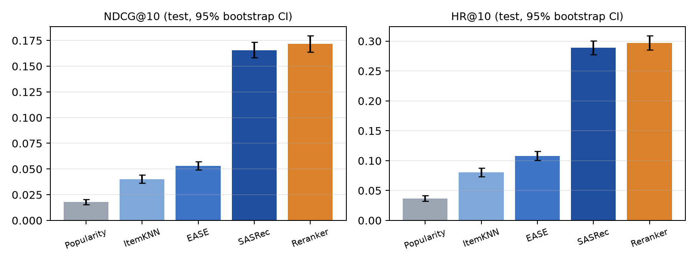
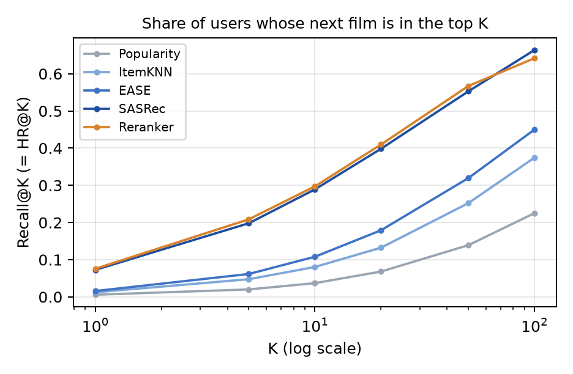
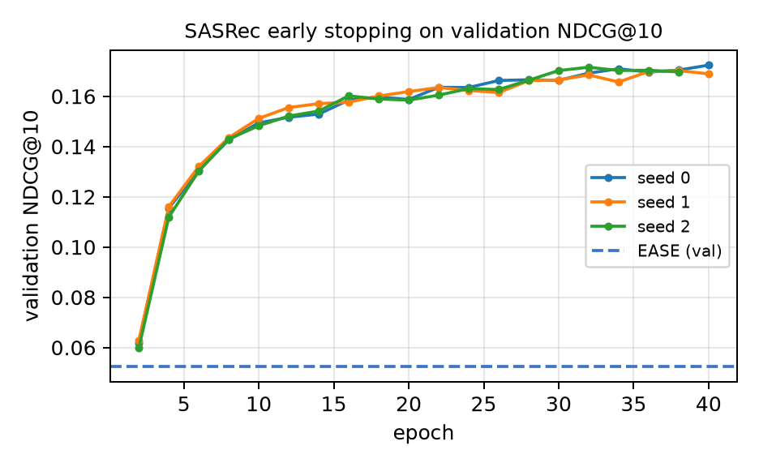
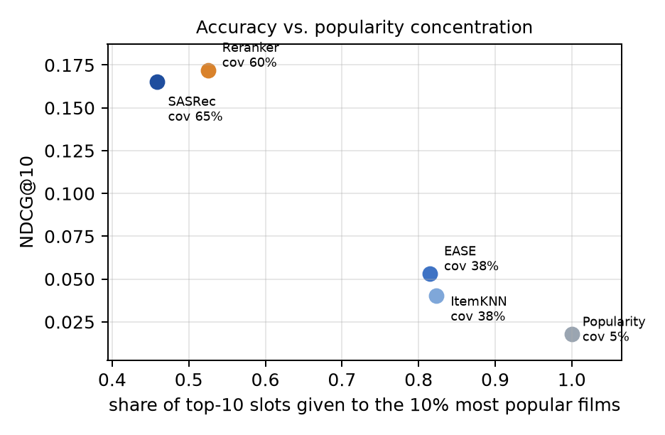

# sequential-recsys

[](https://github.com/rkesseku/sequential-recsys/actions/workflows/ci.yml)

**Sequential recommendation on MovieLens-1M, from candidate retrieval to learned re-ranking, evaluated the strict way.**
Four retrievers (popularity, item-kNN, EASE and a SASRec-style transformer) are compared on one
chronological split. Every user's held-out next film is ranked against the *whole* catalogue rather
than a sample of 100 negatives, and a LightGBM LambdaRank model re-ranks the merged top-100
candidates. Every number below comes from `seqrec run-all` and is stored in
[`docs/results/metrics.json`](docs/results/metrics.json).

## Why this exists

Recommender papers and portfolios often report inflated accuracy because of three shortcuts:
ranking the true item against 100 sampled negatives, ignoring interaction order, or tuning on the
test set. This repo avoids all three. The questions it answers:

1. How much does **modelling the order of a user's history** buy over strong order-agnostic baselines?
   EASE is a well-known, hard-to-beat linear model.
2. Does a **second-stage learned ranker**, the standard retrieval → ranking architecture used in
   production, add anything measurable on top of the best retriever?
3. What happens to **catalogue coverage and popularity bias** as accuracy improves?

## Data

[MovieLens-1M](https://grouplens.org/datasets/movielens/1m/) (Harper & Konstan, 2015):
1,000,209 ratings from 6,040 users on 3,706 films. Every rating is treated as an implicit
interaction. **The GroupLens licence does not allow redistribution, so the data is not in this
repo.** Download `ml-1m.zip` from GroupLens yourself and unzip it to `data/raw/ml-1m/`.

## Protocol

- **Split.** Per user, interactions are sorted by timestamp (ties keep file order). The last item is
  the test target and the second-to-last is the validation target. The rest is training data,
  averaging 163.6 items per user.
- **Ranking.** Each model scores all 3,706 films; films the user has already seen are removed, and
  the target's rank is pessimistic on ties. Metrics: HR@10, NDCG@10, Recall@K (equal to HR@K with
  one target), coverage@10 (share of the catalogue appearing in anyone's top 10) and head share@10
  (share of top-10 slots given to the 10% most-interacted films).
- **No test leakage.** All models are fit on training interactions only. Hyperparameters (item-kNN
  `k`, EASE λ) and SASRec early stopping use validation NDCG@10. At test time each model reads the
  training history plus the validation item.
- **Uncertainty.** 95% percentile bootstrap intervals over users (1,000 resamples), a paired
  bootstrap for model differences, and three SASRec seeds.

## Models

| Model | What it is |
|---|---|
| Popularity | Most-interacted films in training data |
| ItemKNN | Cosine item-item similarity on the binary matrix, shrinkage 10, top-k neighbours (k tuned: 50) |
| EASE | Closed-form item-item autoencoder (Steck, 2019), λ tuned on validation (250) |
| SASRec | Causal self-attention over the last 100 items (Kang & McAuley, 2018): 2 pre-LN blocks, d=64, 1 head, dropout 0.2, shared input/output embeddings, **full softmax cross-entropy** instead of the paper's single sampled negative, Adam lr 2e-3, at most 40 epochs, early stopping (patience 3 evaluations, every 2 epochs) |
| Re-ranker | LightGBM LambdaRank over the top 100 of the merged EASE + SASRec lists. 10 features: EASE, SASRec and ItemKNN score and rank, log popularity, log recent popularity, log history length, genre affinity. Trained on the **validation** targets, evaluated on test |

## Results (test set, 6,040 users)

| Model | NDCG@10 [95% CI] | HR@10 [95% CI] | Recall@50 | Coverage@10 | Head share@10 |
|---|---|---|---|---|---|
| Popularity | 0.0180 [0.0156, 0.0206] | 0.0369 [0.0326, 0.0416] | 0.139 | 5.4% | 100% |
| ItemKNN (k=50) | 0.0403 [0.0364, 0.0443] | 0.0805 [0.0735, 0.0876] | 0.252 | 37.7% | 82.3% |
| EASE (λ=250) | 0.0530 [0.0491, 0.0574] | 0.1079 [0.1005, 0.1159] | 0.320 | 38.1% | 81.5% |
| SASRec (seed 0) | 0.1653 [0.1584, 0.1733] | 0.2891 [0.2778, 0.3007] | 0.553 | 64.8% | 45.9% |
| **Re-ranker** | **0.1719 [0.1639, 0.1796]** | **0.2972 [0.2854, 0.3089]** | 0.567* | 60.0% | 52.5% |

\*The re-ranker can only reorder its 100 candidates. The test target was among them for 64.2% of
users, compared with SASRec's own Recall@100 of 0.664, because half of each candidate list comes
from EASE.

**Paired differences in NDCG@10** (bootstrap over users):

| Comparison | Difference [95% CI] |
|---|---|
| SASRec − EASE | +0.1123 [+0.1050, +0.1204] |
| Re-ranker − SASRec | +0.0066 [+0.0027, +0.0104] |
| EASE − ItemKNN | +0.0128 [+0.0092, +0.0166] |

**Across SASRec seeds** (0, 1, 2), test NDCG@10 is 0.1656 ± 0.0016 (mean ± SD) and HR@10 is
0.2890 ± 0.0003, so the per-user intervals above are not an artefact of one lucky seed.

What the numbers say:

- **Order matters a lot here.** The sequential model triples NDCG@10 over the best order-agnostic
  model. A film fan's next pick depends strongly on what they watched most recently, and EASE and
  ItemKNN discard that signal.
- **The learned ranker adds a small but statistically clear gain** (+0.0066, about 4% relative).
  This gain is about four times the seed-to-seed SD of SASRec, but it is measured against one SASRec
  seed. Most of the ranker's gain comes from SASRec's rank and score (together 70% of the trees' total gain)
  with EASE, recency and genre signals as minor corrections. The ranker's own ceiling is the 64.2%
  candidate recall.
- **Better accuracy came with less popularity concentration.** SASRec gives 46% of top-10 slots to
  the head of the catalogue (EASE: 81%) and covers 65% of the catalogue (EASE: 38%). The re-ranker
  trades a little of that back: head share rises to 52.5% and coverage falls to 60%.






**Compute.** Everything ran on CPU. SASRec took 21–89 minutes of wall-clock time per seed on a
shared 14-core machine (the spread reflects machine load, not the model). With cached checkpoints,
the rest of `run-all` (tuning, EASE, ItemKNN, features, re-ranker, bootstrap) took 120 s.

## Limitations

- **One dataset, one split type.** Leave-last-out per user does not hold out a global time window,
  so other users' later interactions can inform training. This is the standard protocol for this
  benchmark but is not a deployment simulation. A global temporal split would be stricter.
- **Training budget.** Two of the three SASRec seeds reached the 40-epoch cap while validation NDCG
  was still creeping up (see the training plot), so the SASRec numbers are probably slightly
  conservative.
- **SASRec variant.** It uses full softmax cross-entropy and `torch.nn` pre-LN blocks, not the
  paper's exact sampled-BCE setup, so the numbers are not directly comparable to sampled-metric
  results in the literature.
- **Re-ranker fairness.** The ranker is trained on validation targets with the seed-0 SASRec,
  which was itself early-stopped on those same validation targets. Its test evaluation is clean,
  but its training signal is slightly optimistic.
- **Implicit feedback only.** Ratings are binarised, and there are no user or item side features
  apart from genres.

## How to run

```bash
pip install -e ".[dev]"            # CPU torch is enough
ruff check src tests && pytest     # synthetic data only, no downloads
# put MovieLens-1M in data/raw/ml-1m/ first
seqrec train-sasrec --seed 0 --threads 12 --verbose   # optional: train/cache one seed at a time
seqrec run-all --threads 12 --verbose                 # tunes, trains/loads 3 seeds, writes docs/results/
seqrec plots                                          # redraw figures from metrics.json
```

SASRec checkpoints are cached in `results/cache/` (gitignored), so `run-all` reuses them. On some
Windows conda environments, numpy (MKL) and PyTorch load two OpenMP runtimes. If you see
`OMP: Error #15`, set `KMP_DUPLICATE_LIB_OK=TRUE` for the session. CI on Linux does not need this.

The 5-page project brief is at [`docs/brief/brief.pdf`](docs/brief/brief.pdf).

## Layout

```
src/seqrec/
  data.py       loading, chronological split, synthetic logs for tests
  metrics.py    full-catalogue ranks, HR/NDCG, coverage, popularity, bootstrap
  models.py     Popularity, ItemKNN, EASE
  sasrec.py     SASRec-style transformer with early stopping
  rerank.py     candidate merging, features, LightGBM LambdaRank
  pipeline.py   end-to-end experiment -> metrics.json
  plots.py, cli.py
tests/          19 tests on tiny synthetic interaction logs
```

## References

- F. M. Harper and J. A. Konstan. The MovieLens Datasets: History and Context. *ACM TiiS*, 2015.
- W.-C. Kang and J. McAuley. Self-Attentive Sequential Recommendation. *ICDM*, 2018.
- H. Steck. Embarrassingly Shallow Autoencoders for Sparse Data. *WWW*, 2019.

## License

MIT (code). MovieLens data is subject to the GroupLens licence and is not included.
