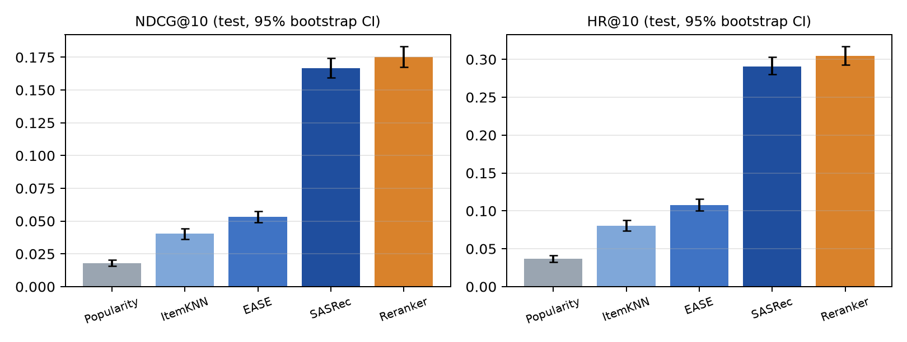
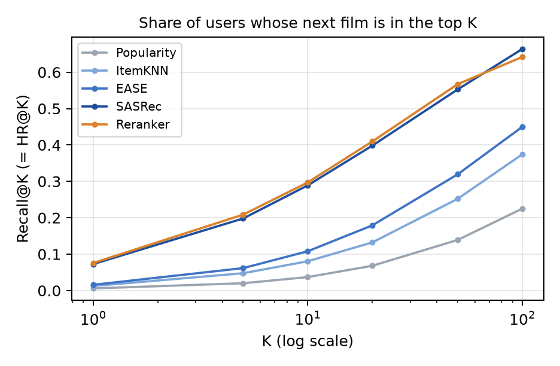
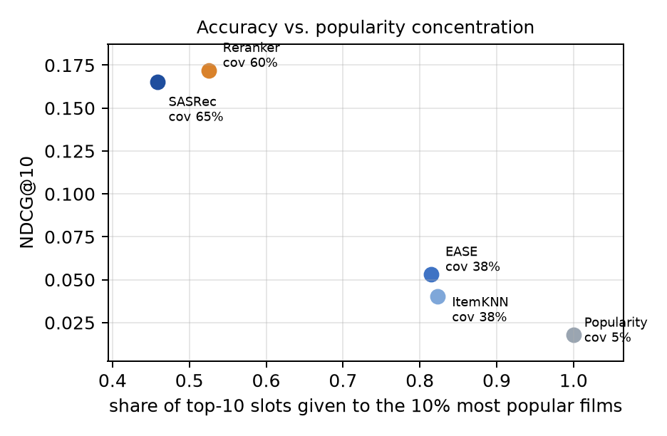
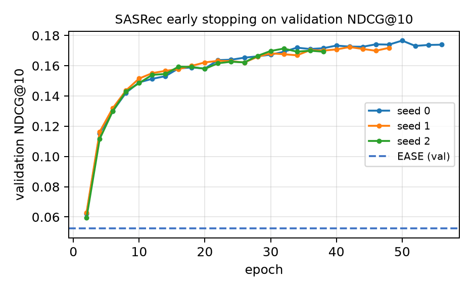

```{=typst}
#show <refs>: set par(hanging-indent: 0.5in, first-line-indent: 0pt, justify: false)
#set text(hyphenate: false)
#set bibliography(title: "References")
#show cite: set text(fill: rgb("#1f4e9e"))
#show bibliography: set par(justify: false)
// Three-rule tables (top, below header, bottom) and bold "Figure N" / "Table N" labels
#set table.hline(stroke: 0.6pt)
#show table: it => box(stroke: (top: 1pt, bottom: 1pt), it)
#show figure.caption: it => context [#strong[#it.supplement~#it.counter.display(it.numbering)#it.separator]#it.body]
#show table: set par(justify: false)
#show heading.where(level: 1): it => block(above: 1.2em, below: 0.6em)[
  #set text(fill: rgb("#1f4e9e"), size: 14pt, weight: "bold")
  #it
]
#show heading.where(level: 2): set text(fill: rgb("#2d2d2d"), size: 11.5pt)
#show table: set text(size: 8.5pt)
#let glance(body) = block(fill: rgb("#eef3fb"), stroke: (left: 3pt + rgb("#1f4e9e")), inset: 10pt, radius: 2pt, width: 100%, body)
// Header: red title, subtitle, author, repository link
#align(center)[
  #set par(justify: false)
  #text(size: 17pt, weight: "bold", fill: rgb("#b91c1c"))[Sequential Movie Recommender]
  #v(0.5em)
  #text(size: 12pt, weight: "bold")[Recommending the next film from a viewing history: retrieval, a transformer and a learned re-ranker, measured against the whole catalogue]
  #v(0.9em)
  #text(size: 11pt)[Reagan Kesseku, Ph.D.]
  #linebreak()
  #text(size: 10pt)[#link("https://github.com/rkesseku/sequential-recsys")[github.com/rkesseku/sequential-recsys]]
  #v(0.45em)
  #text(size: 9.5pt)[#emph[Keywords:] sequential recommendation, self-attention, learning to rank, full-catalogue evaluation, MovieLens]
]
#v(0.5em)
```

```{=typst}
#glance[
*At a glance* \
*Problem:* Given what someone has watched so far, which film will they pick next? Recommenders are often evaluated with shortcuts that inflate accuracy, so it is hard to tell which modelling choices really matter. \
*What I built:* A reproducible pipeline on MovieLens-1M that compares four retrievers (popularity, item-kNN, EASE and a SASRec-style transformer) under a strict chronological, full-catalogue protocol, then adds a LightGBM LambdaRank re-ranker over the merged top-100 candidates. This is the retrieval-then-ranking design used in production systems. \
*Headline result:* On 6,040 held-out next films, with SASRec trained to convergence, NDCG\@10 rose from *0.053 (EASE) to 0.167 (SASRec)* and to *0.175 with the re-ranker* (re-ranker minus SASRec +0.0085, 95% CI [+0.0047, +0.0123]). SASRec also spread recommendations far wider: it covered 65% of the catalogue versus 38% for EASE. \
*Stack:* Python, PyTorch, NumPy/SciPy, LightGBM, pandas, matplotlib, pytest, GitHub Actions. \
*Repo:* #link("https://github.com/rkesseku/sequential-recsys")[github.com/rkesseku/sequential-recsys]
]
```

# The problem

A streaming service, a retailer or a news site faces the same question millions of times a day: *given this person's history, what should we show them next?* Getting it right drives engagement. Getting it wrong wastes the most valuable screen space a product has.

Two design questions dominate real recommender work. First, *does the order of a user's history matter*, or is it enough to know which items they liked? Order-agnostic models such as item-to-item similarity and the linear EASE model are cheap, robust and notoriously hard to beat. Sequence models such as transformers are more expensive and need to earn their place. Second, *is a second-stage ranker worth it?* Production systems usually retrieve a few hundred candidates with fast models and then reorder them with a feature-rich ranker. The ranker adds latency and engineering cost, so its gain should be measured rather than assumed.

## Why evaluation is the real work

Published recommender numbers are often hard to trust, for three common reasons:

- The true item is ranked against only 100 randomly sampled films rather than the whole catalogue, which inflates scores and can even change which model looks best [@krichene2020].
- Interactions are shuffled, so a model can learn from a user's future.
- Hyperparameters are tuned on the test set.

This project avoids all three. Each user's interactions are kept in time order. The last film is held out for testing and the one before it for validation. Every model ranks the *entire* catalogue of 3,706 films, with films the user has already seen removed. All tuning, early stopping and re-ranker training use the validation film only. Results carry bootstrap confidence intervals over users, and the neural model is run with three random seeds.



# Approach

## Architecture

{#fig-arch width=94%}

## Data

MovieLens-1M [@harper2015] contains 1,000,209 ratings by 6,040 users on 3,706 films, with timestamps and genres. Each rating is treated as "this user watched this film". The average user has about 164 training interactions, so there is real sequential signal to exploit. The GroupLens licence forbids redistribution, so the repository contains code only and the README explains how to obtain the data.

## How it works, end to end

1. *Split* (`data.py`). Interactions are sorted by timestamp per user, with ties kept in file order. The last item is the test target, the second-to-last is the validation target, and the rest is training data. At test time, models read the training history plus the validation item.
2. *Baselines* (`models.py`). *Popularity* recommends the most-watched films. *ItemKNN* scores films by cosine similarity to what the user has seen, with the neighbourhood size tuned on validation (best k = 50). *EASE* [@steck2019] learns a full item-to-item weight matrix in closed form with one regularisation parameter, tuned on validation (best λ = 250).
3. *Sequence model* (`sasrec.py`). A SASRec-style transformer [@kang2018] reads the last 100 films in order and predicts the next one at every position. It has two self-attention blocks with 64-dimensional embeddings shared between input and output. It is trained with full softmax cross-entropy over the catalogue and early-stopped on validation NDCG\@10 (at most 120 epochs, checked every 2 epochs with a patience of 3 checks), with seeds 0, 1 and 2. Every seed stopped early, after 56, 48 and 38 epochs respectively.
4. *Re-ranker* (`rerank.py`). For each user, the top-100 lists from EASE and SASRec are interleaved and de-duplicated into 100 candidates. Ten features describe each candidate: the three models' scores and ranks, overall and recent popularity, the length of the user's history, and how well the film's genres match the user's genre profile. A LightGBM LambdaRank model is trained on the users whose *validation* film appears among their candidates (3,631 users, with 403 more for early stopping). It is then applied to the test candidates.
5. *Evaluation* (`metrics.py`, `pipeline.py`). The target's rank among all unseen films gives HR\@10 (is it in the top 10?) and NDCG\@10 (which rewards higher positions), plus Recall\@K curves. *Coverage\@10* is the share of the catalogue that appears in anyone's top 10. *Head share\@10* is the share of top-10 slots given to the 10% most-watched films. Intervals come from 1,000 bootstrap resamples of users, and intervals for differences between models come from a paired bootstrap.




# Results

| Model | NDCG\@10 [95% CI] | HR\@10 [95% CI] | Recall\@50 | Cov.\@10 | Head\@10 |
|--------------------|-------------------------|-------------------------|------------|---------|---------|
| Popularity | 0.018 [0.016, 0.021] | 0.037 [0.033, 0.042] | 0.139 | 5.4% | 100% |
| ItemKNN (k = 50) | 0.040 [0.036, 0.044] | 0.080 [0.074, 0.088] | 0.252 | 37.7% | 82.3% |
| EASE (λ = 250) | 0.053 [0.049, 0.057] | 0.108 [0.101, 0.116] | 0.320 | 38.1% | 81.5% |
| SASRec (seed 0) | 0.167 [0.159, 0.174] | 0.291 [0.280, 0.303] | 0.558 | **64.8%** | **46.8%** |
| Re-ranker | **0.175** [0.168, 0.183] | **0.305** [0.293, 0.317] | **0.569** | 60.5% | 53.7% |

: Test results for 6,040 users, each ranked against the full catalogue with seen films removed. The re-ranker can only reorder its 100 candidates. The true film was among them for 64.5% of users. Bold marks the best value in each column: highest for accuracy and coverage, lowest for head share (less popularity concentration). {#tbl-results}

{#fig-acc width=88%}

I draw three conclusions.

*Order matters a lot.* The transformer triples EASE's NDCG\@10 (paired difference +0.114, 95% CI [+0.106, +0.122]), whereas the two strongest non-sequential models, EASE and ItemKNN, differ by only +0.013. On this data, what someone watched most recently is far more predictive than their overall taste profile. Across three seeds, SASRec's test NDCG\@10 was 0.1662 ± 0.0015 (mean ± SD), so the gap is not the product of a lucky initialisation.

*The second-stage ranker earns a modest, measurable gain.* Re-ranking lifts NDCG\@10 by +0.0085 (95% CI [+0.0047, +0.0123]), about 5% relative and roughly five times SASRec's seed-to-seed spread. An earlier run capped SASRec at 40 epochs, which cut off seed 0 while it was still improving. Training to convergence raised SASRec's NDCG\@10 from 0.1653 to 0.1666, and the re-ranker gain grew from +0.0066 rather than shrinking. The ranker leans mainly on SASRec's rank and score (67% of the trees' total gain), using EASE, recency and genre affinity as corrections. Its ceiling is its candidate pool: the merged list contained the test film for 64.5% of users, slightly fewer than SASRec's own top 100 did (66.8%), because half the slots go to EASE.



{#fig-recall width=62%}

*Higher accuracy did not mean more popularity bias.* It is often assumed that accurate recommenders simply push blockbusters. Here the opposite held. EASE and ItemKNN gave over 80% of their top-10 slots to the most-watched tenth of the catalogue, while SASRec gave 47% and reached 65% of all films. The re-ranker moved back slightly towards popular films (head share 53.7%, coverage 60.5%), a trade-off a product team would want to see before shipping.

::: {layout-ncol=2}
{#fig-pop}

{#fig-train}
:::



# Does tuning help?

The re-ranker uses one fixed LightGBM recipe, so I tested whether a hyperparameter search improves it. I ran Optuna's TPE sampler [@akiba2019] for 100 trials (seed 0, with the fixed recipe enqueued as trial 0) over the number of leaves, learning rate, minimum leaf size, feature and bagging fractions, L2 penalty and the tree cap. Because the ranker is trained on the validation films, those films cannot also be used to score its settings, and carving out a separate time-based split would mean retraining SASRec. Instead, the validation-stage users were split once at random into 4,832 *fit* users, on which each trial trains, and 1,208 *tune* users, on which it is scored by NDCG\@10. Test targets are never read during the search, and a unit test confirms that corrupting them leaves every trial unchanged. Both recipes were then retrained on all validation users and scored once on test for seeds 0--2 (the same seed for SASRec and LightGBM). The search took 3.7 minutes and the whole study 6.6 minutes with 13 threads.

| Recipe | Val. NDCG\@10 | Test, seed 0 | Seed 1 | Seed 2 | Test mean ± SD | HR\@10 mean |
|-----------|-----------------|-----------------|---------|---------|---------------------|---------------|
| Default | 0.1738 | 0.1751 | **0.1755** | 0.1746 | 0.1750 ± 0.0005 | 0.3039 |
| Tuned | **0.1849** | **0.1761** | 0.1732 | **0.1773** | **0.1755** ± 0.0021 | **0.3040** |

: Re-ranker NDCG\@10 with the fixed and the Optuna-tuned LightGBM recipe. Validation scores are on the 1,208 tune users (mean of three LightGBM seeds). Those users also selected the tuned recipe, so its value there is optimistic. Test covers 6,040 users. Bold marks the best (highest) value in each column. {#tbl-tuning}

*Tuning does not help on the test set.* The search lifted tune-user NDCG\@10 by about 0.011, but the test difference (tuned minus default) was +0.0010 (95% CI [−0.0019, +0.0039]) for seed 0, −0.0023 [−0.0058, +0.0015] for seed 1 and +0.0028 [+0.0000, +0.0057] for seed 2. On each user's seed-averaged NDCG\@10 it was +0.0005 [−0.0013, +0.0025], and the tuned recipe varied more across seeds. When retrained on all validation users, the tuned recipe early-stopped after only 3--21 trees, so the small early-stopping hold-out decides more of the final model than the searched settings do. The headline results keep the fixed recipe, and the re-ranker's +0.0085 gain over SASRec stands.

# What this demonstrates

- *Recommender systems end to end:* candidate retrieval with classical and neural models, feature engineering, and learning-to-rank with LambdaRank [@burges2010], the architecture used by large consumer platforms.
- *Evaluation discipline:* chronological splits, full-catalogue ranking, validation-only tuning, bootstrap intervals, paired tests and multiple seeds. Beyond accuracy, the project reports coverage and popularity concentration, the metrics product teams care about.
- *Deep learning from first principles:* a transformer recommender written directly in PyTorch, with early stopping and checkpoint caching, trained on CPU.
- *Engineering:* a small package with one model interface, a CLI that regenerates every reported number, 23 tests on synthetic data and CI on three Python versions.

# Limitations and next steps

- *Protocol.* Holding out each user's last item is the standard protocol for this benchmark, but it does not hold out a global time window, so other users' later behaviour can leak into training. A global temporal split is the natural next check.
- *Budget.* SASRec stops after three validation checks without improvement. All seeds converged well inside the 120-epoch cap, but a longer patience or a learning-rate schedule might still help slightly. CPU multithreading also means that retrained numbers are reproducible only approximately.
- *Variant.* The transformer uses full softmax cross-entropy rather than the original sampled loss, so its numbers should not be compared directly with papers that report sampled metrics.
- *Re-ranker.* It is trained with the seed-0 transformer, which was early-stopped on the same validation targets, so its training signal is mildly optimistic. Its test evaluation is clean. Next steps: a candidate pool weighted towards SASRec to lift the 64% recall ceiling, and session-level features.
- *Scope.* One dataset with binary implicit feedback and only genre side information. Larger catalogues (millions of items) would need approximate nearest-neighbour retrieval in place of full scoring.

# How to run it

```bash
pip install -e ".[dev]"
ruff check src tests && pytest          # synthetic data, no downloads
# unzip MovieLens-1M into data/raw/ml-1m/ (not redistributed)
seqrec run-all --threads 2 --verbose    # writes docs/results/metrics.json + figures
```

SASRec checkpoints are cached per seed and training config in `results/cache/`, so re-running the evaluation takes about two minutes on CPU.

# References {.unnumbered}

::: {#refs}
:::
